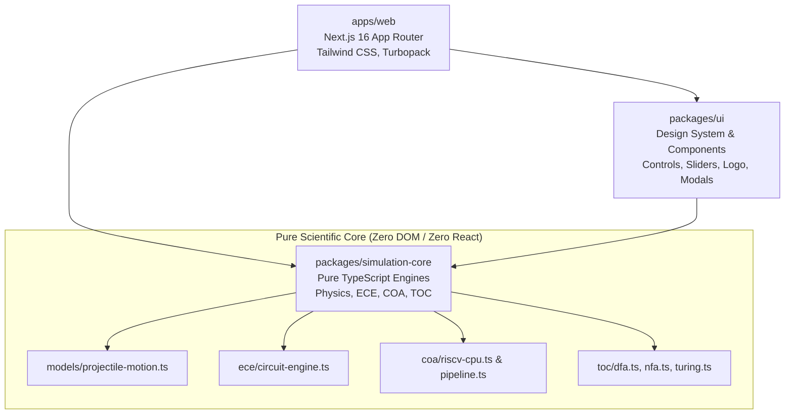

<div align="center">

  

  # 🔬 Prismora Virtual Lab
  ### **Explore. Experiment. Understand.**

  **The Next-Generation Open-Source Scientific Simulation & Engineering Virtual Laboratory Platform**

  [](LICENSE)
  [](https://nextjs.org)
  [](https://www.typescriptlang.org)
  [](https://vitest.dev)
  [](https://playwright.dev)
  [](https://tailwindcss.com)
  [](https://pnpm.io)
  [](https://github.com/iamamits/Prismora-Virtual-Lab/pulls)

  <br />

  <p align="center">
    <a href="#-key-highlights">Key Highlights</a> •
    <a href="#-virtual-laboratories">Virtual Laboratories</a> •
    <a href="#-virtual-instrument-suite">Virtual Instruments</a> •
    <a href="#-architecture--monorepo-design">Architecture</a> •
    <a href="#-curriculum-alignment">Curriculum Map</a> •
    <a href="#-quickstart--local-setup">Quickstart</a> •
    <a href="#-deployment">Deployment</a> •
    <a href="#-contributing">Contributing</a>
  </p>

</div>

---

## 🌟 Overview & Vision

**Prismora** transforms academic engineering and scientific simulation. Traditional virtual laboratories often rely on decades-old static diagrams, legacy Java applets, or clunky server-rendered dashboards with sluggish interactivity.

Prismora unifies:
1. **The Hands-On Approachability of PhET** — direct canvas drag-and-drop, dynamic visual feedback, and intuitive parameter adjustment.
2. **The Precision of Scientific Computation** — analytical closed-form equations, real-time matrix nodal analysis, and zero numerical drift.
3. **The Rigor of B.Tech University Engineering** — complete coverage for GATE, IIT/NIT curricula, KTU, VTU, and Anna University across Electronics, Microarchitecture, and Formal Automata.
4. **100% Client-Side Engine Architecture** — the simulation core runs natively in TypeScript with zero server roundtrips or backend dependencies needed to run simulations.

---

## ⚡ Key Highlights

| Feature | Description |
| :--- | :--- |
| **Pure Solid-Color Light Design System** | Clean, high-contrast, zero-gradient interface engineered for readability, accessibility (WCAG AA), and long laboratory sessions. |
| **Dual Breadboard & Schematic Views** | Switch seamlessly between textbook circuit schematics and photorealistic physical breadboard layouts. |
| **Interactive Testbenches & Instruments** | Dual-channel oscilloscope with timebase & trigger controls, 4.5-digit digital multimeter, and variable waveform function generator. |
| **Hardware & Microarchitecture Sim** | 32-bit RISC-V RV32I single-cycle datapath, 5-stage pipelined CPU with hazard forwarding & bubble insertion, and multi-way associative cache simulators. |
| **Formal Automata & Language Workbench** | Visual DFA/NFA state graphs, Powerset subset construction, Hopcroft minimization, Thompson regex compiler, and $O(n^3)$ CYK grammar parsers. |
| **Built-in Bug Reporting System** | Integrated diagnostics modal capturing reproduction steps, runtime state snapshots, and sanitized hardware context. |
| **Responsive Touch & Canvas Navigation** | Native non-passive event handling with smooth infinite pan, cursor-anchored zoom, and mobile gesture support. |

---

## 🔬 Virtual Laboratories

### 1. ⚡ Electronics & Communication Engineering (ECE)
> **Route:** `/experiments/ece` • Dedicated sub-labs: `/experiments/ece/ohms-law`, `/experiments/ece/diode-rectifier`, `/experiments/ece/adders`

* **Interactive Nodal Matrix Solver:** Real-time simulation of linear & non-linear components (resistors, diodes, capacitors, AC/DC sources, switches, grounds).
* **Dual Rendering Modes:**
  * **Schematic Mode:** Crisp IEEE standard electrical circuit symbology with live node voltages and wire current flow indicators.
  * **Breadboard Mode:** Realistic physical tie-point breadboard with color-coded DIP jumpers, 5-band metal film resistors, and 1N4007 diodes.
* **Featured Interactive Experiments:**
  * **Ohm's Law Verification:** Live $V$-$I$ curve plotting, dynamic slope calculation ($R = \Delta V / \Delta I$), and power dissipation readouts ($P = I^2 R$).
  * **Diode Rectification & Smoothing:** Half-wave and full-wave bridge rectifier circuits with AC input waveform, diode barrier potential drops ($V_d = 0.7\text{V}$), and capacitive ripple filtering ($\Delta V = I_{dc} / (f \cdot C)$).
  * **Combinational Digital Adders:** Interactive Half-Adder and Full-Adder circuit modules with real-time XOR/AND/OR gate propagation and binary truth table tracking.
* **Curriculum Browser:** 200+ topics indexed across Circuit Theory, Analog Electronics, Digital Logic, Signals & Systems, Communication Systems, Control Systems, and Microprocessors.

---

### 2. 🚀 Flagship Physics: Classical Projectile Dynamics
> **Route:** `/experiments/projectile-motion`

* **Analytical Closed-Form Model:** Real-time equations computed in SI units ($m$, $s$, $m/s$, $m/s^2$, $rad$):
  $$x(t) = v_0 \cos(\theta) t$$
  $$y(t) = y_0 + v_0 \sin(\theta) t - \frac{1}{2} g t^2$$
* **Analytical Invariants & Maxima:**
  * **Terminal Flight Time:** $t_f = \frac{v_0 \sin(\theta) + \sqrt{v_0^2 \sin^2(\theta) + 2 g y_0}}{g}$
  * **Apex Height:** $h_{\max} = y_0 + \frac{v_0^2 \sin^2(\theta)}{2 g}$
  * **Horizontal Range:** $R = x(t_f) = v_0 \cos(\theta) t_f$
  * **Mechanical Energy Conservation:** Specific energy $E = \frac{1}{2} v^2 + g y$ tracked across every trajectory frame.
* **Interactive Controls:**
  * Drag-to-aim cannon barrel with angle arc protractor and elevation height platform.
  * Vector decomposition toggles: total velocity $\vec{v}$, component velocities $\vec{v}_x$ & $\vec{v}_y$, and gravitational acceleration $\vec{g}$.
  * Timeline scrubber, slow-motion speed multiplier ($0.1\times$ to $5.0\times$), trajectory trace history, and multi-run snapshot comparisons.

---

### 3. 💻 Computer Organization & Architecture (COA)
> **Route:** `/experiments/coa`

* **RISC-V RV32I Processor Architecture:**
  * **Single-Cycle Datapath:** Program counter (PC), 32-entry register file ($x0 - x31$), ALU with 10 arithmetic/logic operations, Data Memory, and immediate generator.
  * **Control Unit Signals:** Dynamic inspection of `RegWrite`, `ALUSrc`, `MemRead`, `MemWrite`, `MemToReg`, `Branch`, and `Jump`.
* **5-Stage Classic Pipeline Simulator:**
  * Cycle-by-cycle stepping through **IF** (Instruction Fetch), **ID** (Decode), **EX** (Execute), **MEM** (Memory), and **WB** (Writeback).
  * **Hazard Detection & Forwarding:** Real-time visualization of Read-After-Write (RAW) data hazards, forwarding multiplexer activation, and automatic pipeline bubble stall insertion.
  * Live Cycles Per Instruction (**CPI**) calculation and speedup metrics.
* **Interactive Cache Memory Simulator:**
  * Configurable mapping: Direct Mapped, 2-Way Set Associative, 4-Way Set Associative, and Fully Associative.
  * Replacement policies: **LRU** (Least Recently Used) and **FIFO**.
  * Address decomposition breakdown into **Tag**, **Index**, and **Offset** bits with real-time hit/miss rate statistics.

---

### 4. 🧠 Theory of Computation & Formal Languages (TOC)
> **Route:** `/experiments/toc`

* **Finite State Automata:**
  * Interactive canvas to build, inspect, and step through Deterministic (DFA) and Non-Deterministic (NFA) finite automata.
  * Step-by-step character evaluation with active state highlights and acceptance badge.
  * **Powerset Construction Algorithm:** One-click conversion of any NFA (including $\varepsilon$-transitions) into its equivalent minimal DFA.
  * **Hopcroft DFA Minimization:** Automaton state minimization algorithm generating canonical minimal DFAs.
* **Regular Expression Engine:**
  * Regex syntax parser generating Thompson's Construction state machines.
  * Live string membership verification and transition traces.
* **Context-Free Grammars & Parsing:**
  * Cocke-Younger-Kasami (**CYK**) $O(n^3)$ dynamic programming tabular parser for Chomsky Normal Form (CNF) grammars.
* **Turing Machine Simulator:**
  * Bidirectional infinite tape with movable read/write tape head.
  * Educational preset programs: Unary/Binary Incrementer, Palindrome Verifier, and AnBnCn non-context-free language recognizer.

---

## 🛠️ Virtual Instrument Suite

Prismora equips students and engineers with realistic virtual test and measurement instruments:

```
┌─────────────────────────────────────────────────────────────────────────────┐
│                       PRISMORA VIRTUAL INSTRUMENT RACK                      │
├──────────────────────────┬────────────────────────────┬─────────────────────┤
│  OSCILLOSCOPE DUAL-TRACE │     DIGITAL MULTIMETER     │  FUNCTION GENERATOR │
│                          │                            │                     │
│  • CH1 & CH2 Input Wave  │  • 4.5-Digit True RMS      │  • Sine, Square, Tri│
│  • Volts/Div: 10mV - 5V  │  • DC/AC Voltage (V)       │  • Freq: 0.1Hz - 1M │
│  • Time/Div: 1µs - 500ms │  • DC/AC Current (A, mA)   │  • Amplitude: 0-20V │
│  • Edge & Auto Trigger   │  • Resistance (Ω, kΩ, MΩ)  │  • DC Offset Tuning │
│  • Measurement Cursors   │  • Continuity & Diode Check│  • 50Ω Output Imp   │
└──────────────────────────┴────────────────────────────┴─────────────────────┘
```

---

## 🏗 Architecture & Monorepo Design

Prismora is structured as a modular, enterprise-grade `pnpm` monorepo:



### Monorepo Packages

* **`apps/web`**: Next.js 16 (App Router) web application featuring fast client-side navigation, static route prerendering, canvas rendering layers, and API route endpoints.
* **`packages/simulation-core`**: The framework-agnostic mathematical and physical simulation engine written in pure TypeScript. Contains no React, DOM, or Canvas dependencies, enabling standalone unit testing and CLI execution.
* **`packages/ui`**: Dedicated design system library containing accessible controls, parameter sliders, readouts, badges, brand assets, and the universal bug reporting dialog.

---

## 📚 Curriculum Alignment

Prismora's modules are mapped against undergraduate engineering syllabi:

| Subject Code / Discipline | Target Semester | Aligned University Standard | Key Experiments in Prismora |
| :--- | :--- | :--- | :--- |
| **Physics / Classical Mechanics** | Sem 1 / 2 | AICTE First Year Engineering | Analytical Projectile Dynamics, Trajectory Invariants, Energy Conservation |
| **Basic Electrical & Electronics (BEE)** | Sem 1 / 2 | KTU, VTU, AKTU, Anna Univ | Ohm's Law, Diode Rectifiers, RC Filters, Breadboard Prototyping |
| **Digital Logic & Circuit Design (DLD)** | Sem 3 | GATE CSE/ECE, IIT Roorkee V-Labs | Logic Gates, Full Adders, MUX/Demux, K-Map Minimization, Flip-Flops |
| **Computer Organization & Arch (COA)** | Sem 4 | GATE CSE, Hennessy & Patterson | RISC-V RV32I Datapath, 5-Stage Hazard Detection, Associative Caches |
| **Theory of Computation (TOC)** | Sem 5 | GATE CSE, Hopcroft & Ullman | DFA/NFA Powerset, Hopcroft Minimization, CYK Parsing, Turing Machines |

---

## 🚀 Quickstart & Local Setup

### Prerequisites
* **Node.js**: $\ge 20.0.0$
* **pnpm**: $\ge 9.0.0$ (or pnpm 10+)
* **Git**

### 1. Clone & Install
```bash
# Clone the repository
git clone https://github.com/iamamits/Prismora-Virtual-Lab.git

# Enter repository root
cd Prismora-Virtual-Lab

# Install monorepo dependencies
pnpm install
```

### 2. Run Automated Verification Tests
```bash
# Run all 126 unit tests across the workspace (Vitest)
pnpm test

# Run strict TypeScript typecheck on all packages
pnpm typecheck

# Run end-to-end integration tests (Playwright)
pnpm --filter @prismora/web test:e2e
```

### 3. Start Development Server
```bash
pnpm dev
```
Open **[http://localhost:3000](http://localhost:3000)** in your browser to start experimenting.

---

## ☁️ Deployment

Prismora is designed for zero-config, edge-ready deployment on **Vercel** or any standard Node.js container host.

[](https://vercel.com/new/clone?repository-url=https%3A%2F%2Fgithub.com%2Fiamamits%2FPrismora-Virtual-Lab)

### Manual Production Build
```bash
# Build all packages and generate optimized static pages
pnpm build

# Start production server
pnpm --filter @prismora/web start
```

---

## 🎨 Visual Identity & Brand System

Prismora adheres to a strict, accessible design ethos:
* **Light Theme Exclusively:** Ensures maximum readability and mimics clean laboratory notebooks.
* **No Gradients:** Uses solid spectral accents with clear semantic associations:
  * 🔵 **Electric Blue** (`#2563EB`) — Physics & Analytical Dynamics
  * 🔴 **Coral Red** (`#F43F5E`) — Electronics, Circuit Theory & Signals
  * 🟣 **Royal Violet** (`#8B5CF6`) — Mathematics, Automata & Formal Grammars
  * 🟢 **Emerald Green** (`#10B981`) — Digital Logic & Gate Primitives
  * 🟡 **Amber Gold** (`#F59E0B`) — COA, RISC-V Pipelines & Cache
* **Monospace Precision:** All numerical values, scale markers, coordinates, and equations are rendered in `JetBrains Mono`.

---

## 🤝 Contributing

Contributions are warmly welcomed! Whether you are:
- Adding a new laboratory experiment (e.g., BJT amplifiers, Fourier Transforms, Sorting Algorithms)
- Enhancing simulation solvers in `@prismora/simulation-core`
- Improving UI components and mobile touch ergonomics

Please see our [CONTRIBUTING.md](CONTRIBUTING.md) guide and adhere to our Code of Conduct.

```bash
# Create your feature branch
git checkout -b feat/my-new-experiment

# Ensure tests and typechecks pass
pnpm -r typecheck
pnpm -r test

# Commit your changes
git commit -m "feat(lab): add BJT common emitter amplifier simulation"
```

---

## 📄 License

This project is licensed under the **MIT License** — see the [LICENSE](LICENSE) file for details.

---

<div align="center">
  <sub>Built with ❤️ for curious minds, researchers, and engineers worldwide by <a href="https://github.com/iamamits">Amit Singh</a> and the Prismora Community.</sub>
</div>
